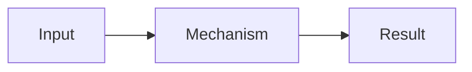

# Explanatory Answer

Answer the question first. Then help the reader understand how the answer follows from the relevant facts. Use the order below for an explanation; a simple fact may need only the direct answer.

## Explain

1. **Answer:** Respond directly to the question.
2. **Why or how:** Explain the mechanism in a clear sequence.
3. **Reasoning:** Connect the relevant facts to the conclusion; cite evidence when needed. Identify material assumptions or uncertainty, and do not leave a key step for the reader to guess.
4. **Example:** Add one only if it makes the explanation easier to grasp.
5. **Implication:** Say what follows or what to do, when relevant.
6. **Diagram (optional):** Add a compact Mermaid diagram when a visual makes the explanation clearer.

Use these headings in this order when a longer answer benefits from structure. Omit optional sections when they add nothing, and do not repeat the same point under multiple headings.

## Optional diagram

When a relationship, branch, or sequence is easier to understand visually, add a compact Mermaid diagram if the destination renders it. Explain the conclusion in text as well. Keep labels and connections grounded in the same facts as the prose; omit decorative nodes and unsupported branches.

If Mermaid is unavailable, express the same relationship in text.
