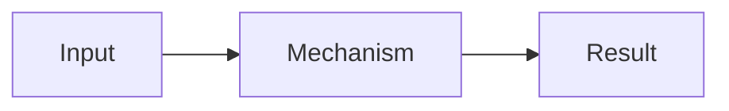

# Explanatory Answer

Answer the question first. Then help the reader understand how the answer follows from the relevant facts. Adjust depth to the question: a simple fact may need one sentence, while a complex mechanism may need several steps.

## Explain

1. **Answer:** State the conclusion directly in familiar terms.
2. **Why or how:** Describe the mechanism or cause in a sensible order.
3. **Reasoning:** Connect the facts to the conclusion. Identify assumptions and distinguish observed facts from inferences when that distinction matters. Do not leave a key step for the reader to guess.
4. **Support:** Cite a source, show a calculation, or give a concrete example when it helps establish or illustrate the answer. State material uncertainty when the evidence is incomplete.
5. **Implication:** Add a practical consequence or next step only when it helps answer the question.

Use headings such as **Answer**, **Why**, and **Reasoning** when they make a longer response easier to scan. Do not force every heading into a short answer or repeat the same point under multiple headings.

## Optional diagram

When a relationship, branch, or sequence is easier to understand visually, add a compact Mermaid diagram if the destination renders it. Explain the conclusion in text as well. Keep labels and connections grounded in the same facts as the prose; omit decorative nodes and unsupported branches.

For a direct mismatch or a one-step answer, prose is usually clearer. If Mermaid is unavailable, express the same relationship in text.
