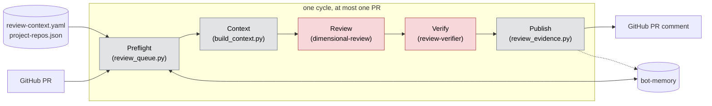
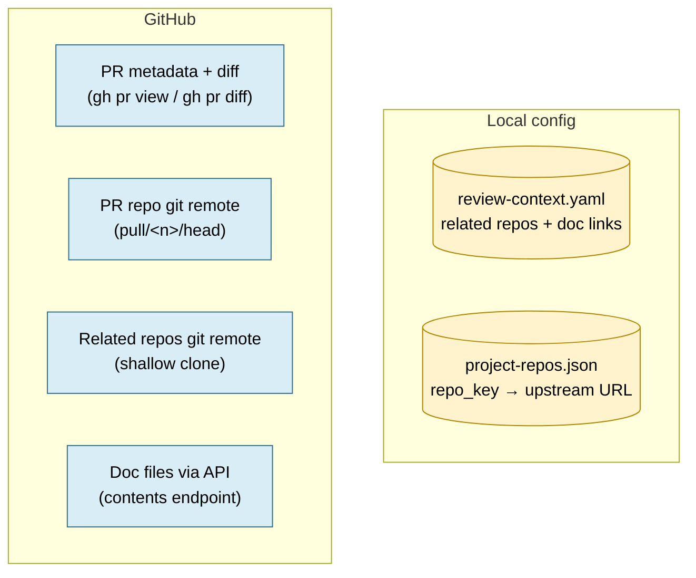
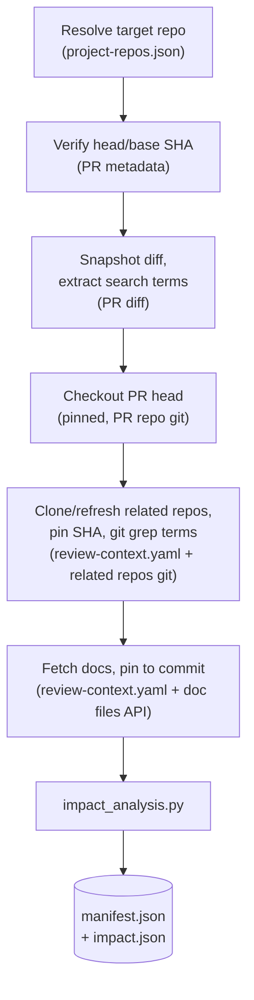
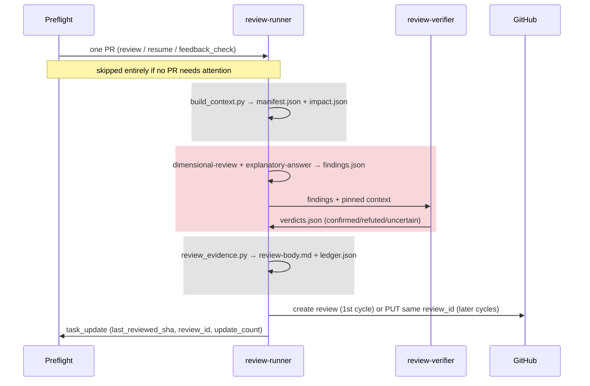

# review-only workflow

`rbac-config-review` is a separate, review-only Rehor bot instance (not yet
deployed). Each cycle it reviews at most one GitHub PR labeled in
`review-context.yaml`, across the repositories in `project-repos.json`. It
never edits, commits, pushes, approves, requests changes, or merges — it
keeps exactly **one** GitHub review comment per PR, editing it in place each
cycle rather than posting a new one.

## Stages



Gray = deterministic script, $0, no model call. Red = an LLM reasons over
pinned context and can be wrong. Only `C`/`D` spend tokens; `A`/`B`/`E` are
plain Python and run every cycle regardless of whether anything needs review.

| Piece | File | Script or AI | Role |
|---|---|---|---|
| Queue | `preflight/01-review-queue.py` → `review_queue.py` | Script | Picks one labeled PR needing `review`, `resume`, or `feedback_check`; enforces the 10-task capacity limit and per-instance task isolation (`review-only:github:` prefix) |
| Config validation | `review_config.py` | Script | Loads and strictly validates `review-context.yaml` (GitHub URL shape, `.md`-only doc links, unique ids) |
| Context builder | `build_context.py` | Script | Checks out the PR head read-only, clones related repos at a pinned SHA, fetches configured Markdown docs at a pinned commit, writes `manifest.json` |
| Impact analysis | `impact_analysis.py` | Script | Deterministically (no LLM) extracts changed identifiers from the diff and `git grep`-matches them in related repos → `impact.json`'s `consumer_usages` (candidates, not confirmed breakage) |
| Review criteria | `skills/dimensional-review/SKILL.md` | **AI** (review-runner) | Multi-dimension review (correctness, security, `cross-repo-dependencies`, …) over the pinned context; deduped and consensus-scored |
| Explanation quality | `skills/explanatory-answer/SKILL.md` | **AI** (review-runner) | How to write each finding's `claim`/`trigger`/`impact`/`evidence`/`suggested_fix` so it's specific and cited, not generic filler that happens to pass validation |
| Verifier | `.opencode/agents/review-verifier.md` | **AI** (subagent) | Independently tries to refute every proposed finding using only pinned sources |
| Evidence gate | `review_evidence.py` | Script | Rejects any finding whose location/reference isn't a real pinned line; caps at seven findings; requires one verdict per finding; renders the final review body |

## The task queue: review_queue.py

Runs every cycle, for $0, before any AI session. For every repo in
`project-repos.json`, it lists open PRs carrying `review_label` and classifies
each one — a session only launches if a PR survives all of this:

1. **Filters out**: drafts, PRs authored by the bot itself, PRs missing a
   head/base SHA, and PRs `paused` for that exact same SHA pair.
2. **Classifies survivors** into exactly one of three kinds (first match
   wins):

   | Kind | Condition | Priority |
   |---|---|---|
   | `resume` | Task status is `in_progress`/`pr_open`/`pr_changes` — a prior cycle was interrupted | 0 (highest) |
   | `review` | No task yet, or current head/base SHA differs from `last_reviewed_sha`/`last_reviewed_base_sha` | 1 |
   | `feedback_check` | SHA unchanged, but `updatedAt` is newer than `last_seen_updated_at` | 2 (lowest) |

   Everything else (already reviewed, nothing newer) is excluded.
3. **Picks exactly one** candidate across every repo, sorted by
   `(priority, updatedAt, repo, number)` — one PR per cycle, oldest
   highest-priority first.
4. **Capacity gate**: a brand-new `review` is skipped if 10 tasks are already
   active, even if otherwise eligible.

### What identifies a task

Every task has three identity fields, always used together:

- **`external_key`** — `task_key(repo, number)` =
  `review-only:github:<owner>/<repo>#<number>` (e.g.
  `review-only:github:project-kessel/insights-rbac#42`). Built once in
  `review_queue.py` and threaded through every subsequent `task_get`/
  `task_update` call for that PR.
- **`source_type`** — always `"github"` (this instance reviews GitHub PRs
  only; a GitLab MR would need an `"gitlab"` adapter, not built).
- **`instance_id`** — `$BOT_INSTANCE_ID` (e.g. `fabric-access-review`).

All three matter because bot-memory is **shared** across instances —
`rbac-config` (the Jira sprint bot), `rbac-config-konflux`, and this review
instance can all have tasks in the same memory server. `review_queue.py`'s
`load_tasks()` filters strictly on
`source_type == "github" and external_key.startswith("review-only:github:")`
— so even a task for the exact same PR number created by a different
instance is invisible to this one. There is no author-based or label-based
task filtering; the `external_key` prefix *is* the isolation boundary.

### Memory: task state vs. the shared RAG store

`bot-memory` provides two different things, and this instance treats them
differently. **Task state** (`task_add`/`task_update`/`bot_status_update`) —
the SHA pairs, `review_id`, `update_count`, `ledger_path` above — is this
instance's own bookkeeping and stays fully read/write; the pipeline can't
function without it. The **shared RAG learning store**
(`memory_store`/`memory_search`, categories `learning`/`review_feedback`/
`codebase_pattern`, also readable team-wide via the read-only `team-memory`
MCP endpoint) is read-only for this instance — `review-runner.md`'s
permissions deny `bot-memory_memory_store` and `bot-memory_memory_delete`.
It still searches that store for leads (AGENTS.md step 2), it just never
writes a new learning or feedback entry to it; its own history lives in task
state, not shared memory.

## Building context

What `build_context.py` actually does, zooming into the "Context" stage box
above — every fetch is pinned to an exact SHA/commit as it happens:

**Data sources** — everything `build_context.py` reads from outside itself:



**Pipeline** — each step names the source(s) it consumes, in order:



A failed related-repo clone or doc fetch doesn't abort the run — it's
recorded as `{"error": ...}` on that one entry, surfaced later as
`unavailable_sources` rather than silently skipped.

### manifest.json: the trust boundary

The complete, pinned snapshot: the PR's identity and SHAs, the local
checkout path, each related repo's pinned SHA/path/grep matches, each
fetched doc's pinned permalink, and a pointer to `impact.json`.

It exists because the pipeline needs one object that answers "what did we
actually fetch, and at exactly which revision?" — and that object then
doubles as the **authorization list for evidence**. `review_evidence.py`'s
`validate_ref()`/`source_root()` reject any finding whose cited `{repo, sha,
file, line}` isn't something `manifest.json` actually pinned. A finding can't
invent a convenient-sounding reference to a repo or revision nobody fetched —
only what's in the manifest is citable at all.

### impact.json: the cheap cross-repo pre-filter

A deterministic (no LLM), purely textual report: which identifiers changed
in the diff, and which related-repo `git grep` hits also contain one of
those identifiers (`consumer_usages`) — each tagged `"status": "candidate"`,
plus `unavailable_sources` for anything that failed to fetch.

It exists so the AI reviewer doesn't have to manually re-search every
related repo for every changed name on every cycle — that's slow and
expensive to do by hand, in an LLM turn, for each identifier. The script
does that legwork once, cheaply, and hands the `cross-repo-dependencies`
dimension a shortlist of concrete candidates to check instead. It is
explicitly leads, not verdicts: plain string matching can't tell a real
dependency from a coincidental name collision, which is exactly why a
candidate still has to survive the review skill's judgment, review-verifier's
refutation, and `review_evidence.py`'s pinned-reference check before it can
become a published finding.

## One review cycle



Gray bands are script (no model call); the red band is where an LLM
actually reasons — review-runner proposing findings, and review-verifier
trying to refute them.

## Finding shape

`dimensional-review`'s MERGE output is converted into this schema before the
verifier/evidence steps — see the skill's own **Step 5 Override:
rbac-config-review Workflow Output** section for the exact field mapping:

```json
{
  "findings": [
    {
      "id": "F1",
      "category": "cross_repo|contract|deploy|invariant|local",
      "location": {"repo": "owner/repo", "file": "path", "line": 1, "side": "added|removed"},
      "claim": "...",
      "trigger": "specific input or code path",
      "impact": "...",
      "evidence": {
        "explanation": "...",
        "refs": [{"repo": "owner/repo", "sha": "40-character pinned SHA", "file": "path", "line": 1}]
      },
      "suggested_fix": "..."
    }
  ]
}
```

A `cross_repo` finding must cite a concrete related-repository reference —
normally a `consumer_usages` entry from `impact.json` — never the
`review-context.yaml` relationship declaration alone.

## Ledger: one review, updated over time

From a task's second cycle onward, `review_evidence.py` also takes a prior
`ledger.json` (every finding ever confirmed for this task, each `open` or
`addressed`) and a proposed re-check of each `open` entry:

```json
{"verifications": [
  {"finding_id": "F1", "status": "addressed|still_open|uncertain",
   "explanation": "...",
   "refs": [{"repo": "owner/repo", "sha": "...", "file": "path", "line": 1}]}
]}
```

`refs` is required only for `"addressed"` — review-verifier must also confirm
those (same adversarial check as new findings) before the ledger entry closes.
`"still_open"`/`"uncertain"` need no verdict. One re-check per currently-open
entry is required; the merged result becomes the new `ledger.json`, and the
posted review body gets two sections — *Previously Flagged* (carried entries,
✅ addressed or ⚠️ still open) and *New Findings* (this cycle's) — plus an
`update #N` counter in the header.

## Example comments

Both generated by actually running `render_review`/`render_ledger`, not
hand-written. F1's fields below are what `skills/explanatory-answer/SKILL.md`
asks for applied directly: `claim` is the direct assertion, `trigger` is the
concrete input, `impact` is the specific consequence, `evidence` cites a
pinned line instead of a remembered impression of HBI's code.

**First cycle** (`render_review` — no ledger yet):

```markdown
## Review

### F1: Old permission name disappears while HBI still sends it

Location: `api/permissions.py:1`

Trigger: HBI calls check_permission("inventory.read_hosts") on every host-read request

Impact: HBI requests to the inventory API are rejected with 403 after this PR merges

Evidence: HBI's client.py still sends the old permission string

- [RedHatInsights/insights-host-inventory:client.py:1](https://github.com/RedHatInsights/insights-host-inventory/blob/c3c3.../client.py#L1)

Suggested fix: Keep inventory.read_hosts as an accepted alias until HBI migrates

<!-- fabric-access-review:a1a1...:b2b2... -->
```

**Follow-up cycle, same comment edited in place** (`render_ledger` — F1 got
fixed, F2 is still open, and F3 is new this cycle — the mixed case that
shows what the status comment is actually for):

```markdown
**Review status** — update #3 • reviewed through `d4d4d4d4d4d4`

## Previously Flagged

### F1: Old permission name disappears while HBI still sends it — ✅ Addressed

Location: `api/permissions.py:1`

Fix evidence: Commit adds ALIAS = "inventory.read_hosts" alongside the new permission name
- [project-kessel/insights-rbac:api/permissions.py:2](https://github.com/project-kessel/insights-rbac/blob/d4d4.../api/permissions.py#L2)

### F2: Unbounded retry loop with no backoff — ⚠️ Still open

Location: `api/permissions.py:4`

Status: sync() still retries with no backoff or max-attempts check

## New Findings

### F3: New ALIAS constant is not validated against the active permission schema

Location: `api/permissions.py:2`

Trigger: A consumer requests inventory.read_hosts after the alias list changes again

Impact: Silently grants or denies access inconsistently with the documented schema

Evidence: ALIAS is a bare string with no schema validation nearby

- [project-kessel/insights-rbac:api/permissions.py:2](https://github.com/project-kessel/insights-rbac/blob/d4d4.../api/permissions.py#L2)

Suggested fix: Validate ALIAS entries against the permission schema at startup

<!-- fabric-access-review:d4d4...:b2b2... -->
```

These two are the PR review comment (GitHub). Separately, `bot_status_update`
("Use bot_status_update with this instance ID at cycle start and end",
AGENTS.md) drives the dashboard banner, not a PR comment — `state`
(`working`/`idle`/`error`), `message`, `external_key?`, `repo?`,
`instance_id?`:

```
bot_status_update(instance_id="fabric-access-review", state="working",
  message="Reviewing PR #42", external_key="review-only:github:project-kessel/insights-rbac#42",
  repo="insights-rbac")
...
bot_status_update(instance_id="fabric-access-review", state="idle",
  message="Posted review comment (update #2)")
```

or, when preflight found nothing to do that cycle:

```
bot_status_update(instance_id="fabric-access-review", state="idle",
  message="No PR needs review")
```

## Guardrails

- **review-runner** permissions deny `edit`, all subagents except
  `review-verifier`, `webfetch`, `websearch`, and the shell patterns
  `git push*`, `git commit*`, `gh pr merge*`, `gh pr edit*`, `gh pr
  review*--approve*`.
- **review-verifier** permissions deny `edit`, `shell`, all subagents,
  `webfetch`, and `websearch` — it can only reason over the context it's
  given.
- Idempotency: a task's `review_id` (once set) means every later cycle edits
  that same review via `PUT .../reviews/<review_id>` instead of posting a new
  one — there is at most one review comment per PR, ever. A
  `<!-- fabric-access-review:<head_sha>:<base_sha> -->` marker in the body
  records which revision it currently reflects. `feedback_check` cycles never
  touch `review_id` — they only log human replies to memory.
- Related repositories and linked docs are read-only context — they never
  expand the PR queue, and `review-context.yaml` is the only source of
  cross-repo relationships (no inferring or fetching unlisted repos).

## Related

- `AGENTS.md` (this workflow) — full step-by-step instructions
- `skills/dimensional-review/SKILL.md` (`../../skills/dimensional-review/SKILL.md`) — dimension catalog and the `rbac-config-review`-specific dispatch/output overrides
- `skills/explanatory-answer/SKILL.md` (`../../skills/explanatory-answer/SKILL.md`) — how to write a finding's or re-check's explanatory fields
- `../../review-context.yaml` — declared repo relationships and doc links
- `../../../../../dev-bot/docs/presets/custom-preflight.md` — the `start`/`skip`/`error` preflight contract `01-review-queue.py` implements
